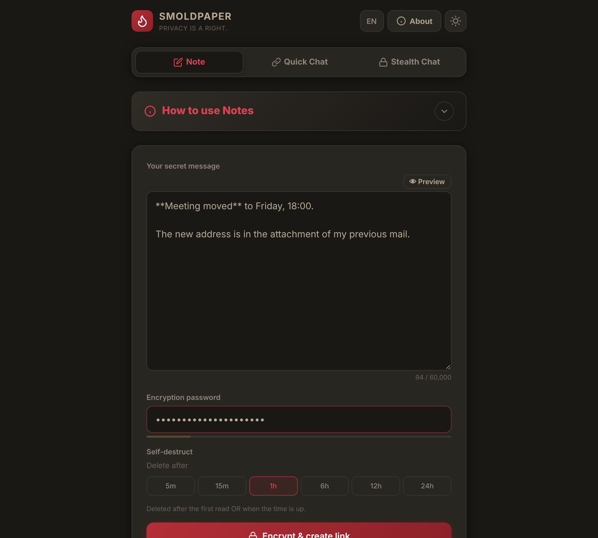
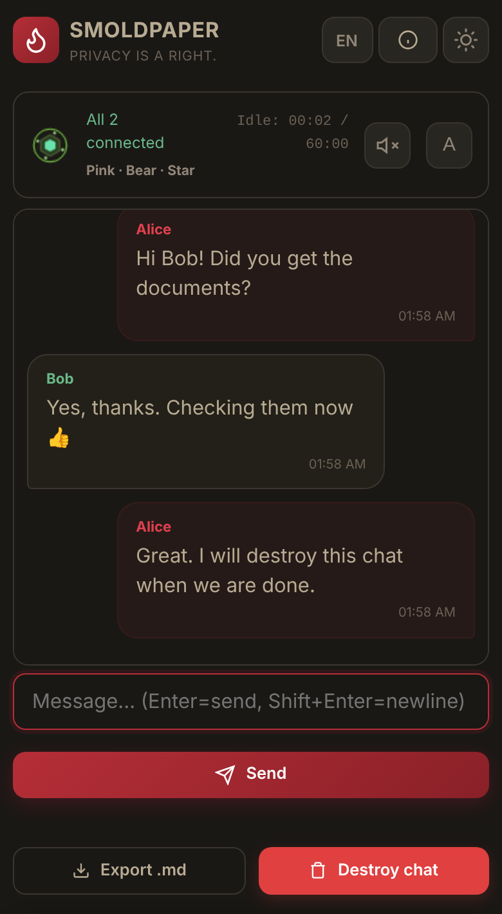
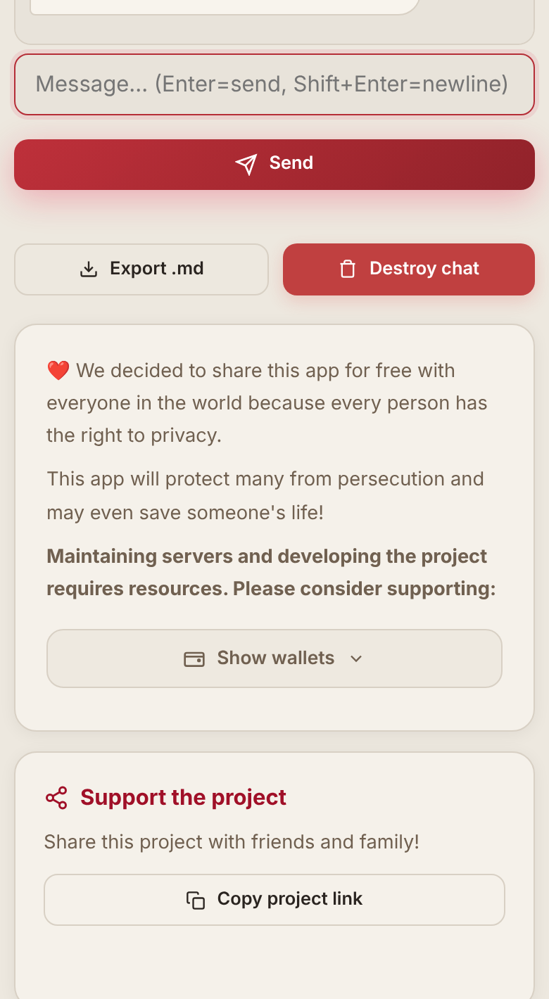
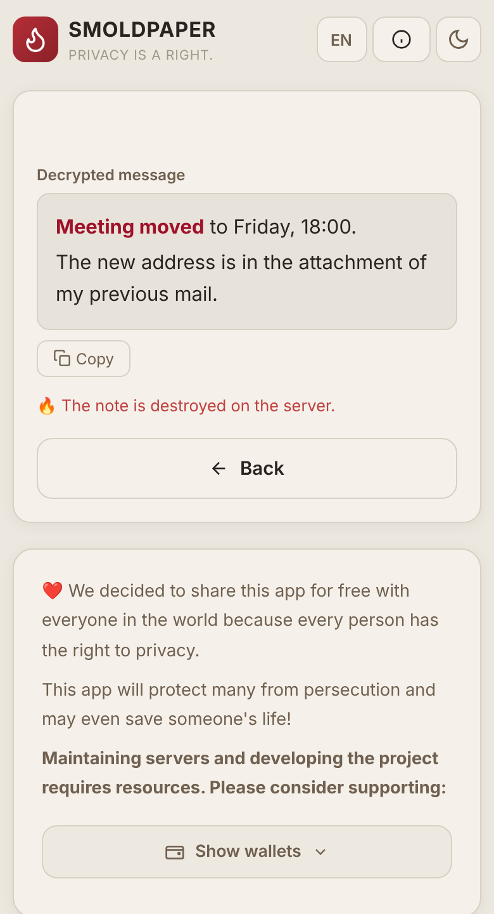
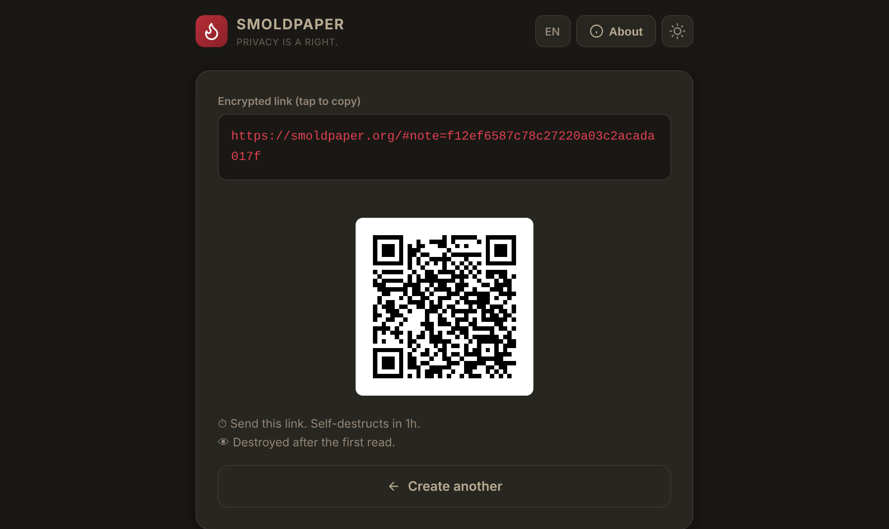
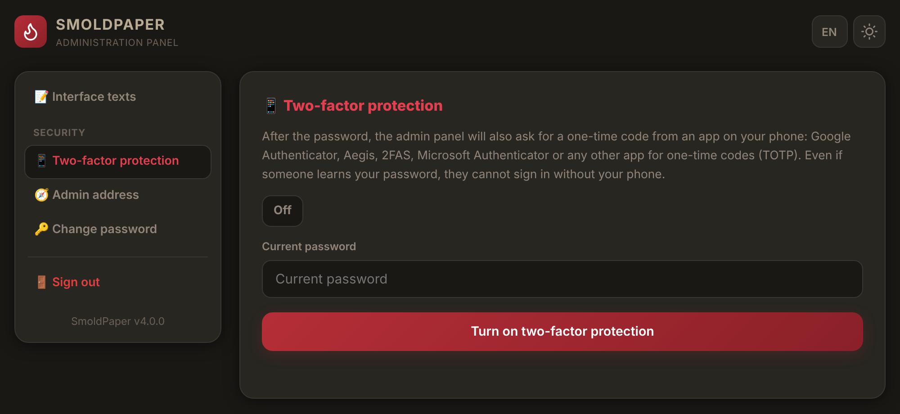

<div align="center">

# 🔥 SmoldPaper v4.0.0

### *Privacy is a Right.*

**Open-Source Zero-Knowledge Secure Drop Box & Stealth Chat**

[](LICENSE)
[](https://php.net)
[](#)
[](#-installation)

[**🌐 Live Demo**](https://smoldpaper.org) · [**📸 Screenshots**](#-screenshots) · [**🚀 Install**](#-installation) · [**🛡️ Security**](#-how-the-cryptography-works) · [**🎭 Protocol**](#-the-stealth-protocol) · [**💎 Pro**](#-smoldpaper-pro)

---

*In an era where every written word settles forever on corporate servers,*
*we brought back the magic of secret letters that turn to ash.*

</div>

---

## 💡 What is SmoldPaper?

SmoldPaper is a free, self-hosted, client-side encrypted platform for exchanging sensitive information. It lets two people talk across **compromised or monitored channels** – Telegram, WhatsApp, Discord – without leaving readable data on the server.

**No accounts. No analytics. No IP logging. No external requests.**

Everything is encrypted in your browser. The server stores only ciphertext and never receives your passwords or keys.

---

## 📸 Screenshots

<p align="center">
  
</p>

<table>
  <tr>
    <td align="center" width="33%"><br><sub>Quick Chat, dark theme</sub></td>
    <td align="center" width="33%"><br><sub>The same chat on the other phone</sub></td>
    <td align="center" width="33%"><br><sub>The note is read and burned</sub></td>
  </tr>
  <tr>
    <td align="center" colspan="2"><br><sub>Every note and invite gets a link and a QR code</sub></td>
    <td align="center"><br><sub>Protected admin panel with 2FA</sub></td>
  </tr>
</table>

---

## 🏗️ Three Files

| File | Purpose |
|------|---------|
| `index.html` | The whole frontend – interface, encryption, 5 languages, Markdown, QR codes |
| `api.php` | The whole backend – API, SQLite database, cleanup, rate limiting |
| `admin.php` | Hidden admin panel – interface texts and admin protection |

Plus `manifest.json` and `favicon.svg`. No Node.js, no Docker, no npm, no build step, no CDN. Drop the files on any cheap PHP hosting.

---

## ✨ Features

### 🔐 Burn-after-Reading Notes

Write a note, protect it with a password, get a link and a QR code. The note is deleted from the database right after it is read with the right password, or when its time is up: 5 minutes, 15 minutes, 1, 6, 12 or 24 hours. Opening the link alone spends nothing. After 5 wrong passwords the note destroys itself.

Notes support **Markdown** with a live preview and hotkeys: Ctrl/Cmd + B, I, U, K.

### 💬 Quick Chat

Create an encrypted room, send the invite link (or show the QR code), and your contact enters the shared password. A wrong password is refused at the door. Once two people are in, the room is **sealed** – nobody else can join, even with the link and the password. When you are done, destroy it: the old link becomes a dead end.

### 🕵️ Stealth Chat

Designed for hostile environments. You agree with your contact on a password and a code word. Then you chat normally in any messenger. When a message with the code word appears, that whole message becomes the key to a hidden room in SmoldPaper. To an outside observer nothing unusual happened.

### 🔄 Back After a Reload

If a page reloads by accident, SmoldPaper offers to return to the same chat: enter the password (and for Stealth Chat the phrase) again and you get your seat and the history back. The encryption key is never stored – not even in the browser. Your contact sees "Partner left" while you are away.

### 🔑 Anti-MITM Visual Hash

A visual fingerprint (Color · Animal · Object) derived from the room. Both people must see the same words – if they differ, something is wrong.

### 🌍 5 Languages, Themes, PWA

English, Русский, Deutsch, Français, Español. Dark and light themes, font sizes, notification sounds, mobile-first layout, installable as an app.

### 🛠️ Protected Admin Panel

Edit every interface text in all 5 languages, set video guides, and protect the panel itself: a secret address, a strong password, sign-in limits and optional two-factor codes (Google Authenticator, Aegis and others).

---

## 💎 SmoldPaper Pro

This repository is the free edition. It is complete and stays free: everything described here works without Pro.

**SmoldPaper Pro** is the extended edition for teams, communities and anyone who needs more. It is built on the same code and the same encryption, is developed continuously and gets new features first. Pro is not open source and is not published here.

What Pro adds:

| Feature | Free | Pro |
|---------|------|-----|
| Encrypted file attachments in notes and chats | – | ✅ several files per note (10 by default, set by the owner), up to 25 MB each, drag & drop |
| Chat size | 2 people | up to 10 people (Quick and Stealth) |
| Reads per note | 1 | up to 100 |
| Note lifetime | 5 min – 24 h | up to 7 days, or an exact date and time (up to a year) |
| Your branding: name, subtitle, logo, footer, custom CSS | – | ✅ |
| Password for the whole site | – | ✅ |
| Settings: file size, password attempts, chat sizes and lifetime, which tabs and timers are shown | – | ✅ |
| Dashboard: notes, active chats, files, disk space | – | ✅ |
| Event log without IP addresses, CSV export | – | ✅ |
| Your own donation wallets, or no donation block | – | ✅ |
| Admin panel protection, 2FA, 5 languages | ✅ | ✅ |

**To get SmoldPaper Pro, write to the author:** [onbidon@proton.me](mailto:onbidon@proton.me)

---

## 🎭 The Stealth Protocol

### Step 1 – The Agreement
Agree with your contact on a **shared password** and a **code word**. Do it in person or over a channel you trust. Once is enough.

### Step 2 – The Signal
Chat normally anywhere. To start a secret conversation, send a message with the code word, for example:
> *"**Buddy**, take a look at the report when you can."*

### Step 3 – The Entry
Your contact copies the **entire message**, opens SmoldPaper → Stealth Chat, pastes it as the phrase (at least 25 characters) and enters the shared password. You are both in the same encrypted room. The same phrase leads to different rooms on different SmoldPaper sites.

### Step 4 – Read & Burn
Talk. When you are done, destroy the room. 🔥

---

## 🛡️ How the Cryptography Works

```
Password ──► PBKDF2-SHA256, 600 000 iterations ──► HKDF
                                                    │
                       ┌────────────────────────────┴───────────────┐
                       ▼                                            ▼
             AES-256-GCM key                             access token / check value
       (never leaves the browser)                 (the server keeps only its SHA-256)
                       │
                       ▼
        IV + ciphertext ──► server stores only this
```

- **Notes:** a random salt per note. The server hands out the ciphertext and counts a read only for the right access token – nobody gets the encrypted note without the password.
- **Chats:** the room id is the salt. A "check value" derived from the password lets the server refuse a wrong password without ever knowing it. Every member has a random token; the server stores only its hash and takes the sender of a message from it.
- **Stealth rooms:** the phrase goes through its own PBKDF2 (600 000 iterations, salted with the site address). Half of the result is the room id, the other half is mixed into the key and never sent.
- **AES-GCM** detects any change: altered data simply does not decrypt.
- **Web Crypto API** of the browser – no JavaScript crypto libraries.

A short or common password is still a weak password – use a long phrase.

---

## 🚀 Installation

### Requirements
- A web server with **PHP 7.4+** (tested on PHP 8.3) – Apache, Nginx or LiteSpeed
- The **PDO SQLite** extension (enabled on almost every hosting)
- **HTTPS** – browsers allow encryption only on secure pages

### Quick Start

1. Download the [latest release](https://github.com/0xSmold/smoldpaper/releases).
2. Upload `index.html`, `api.php`, `admin.php`, `manifest.json` and `favicon.svg` to your site. Always upload `api.php` and `admin.php` together.
3. Open your site. The `data` folder, the database and the protection files are created automatically.

### Nginx

Apache and LiteSpeed read the `.htaccess` file that SmoldPaper writes into `data`. Nginx ignores it, so add this rule to your server block:

```nginx
location ^~ /data/ { deny all; return 404; }
```

Check: opening `https://your-site/data/` must show 404 or 403. Service files inside `data` start with a PHP `exit` line, so they show nothing even without the rule – the rule hides the database file.

### Optional: Video Guides

The "How to use" blocks can show short videos. Download them from the assets of the [latest release](https://github.com/0xSmold/smoldpaper/releases) and put the MP4 files next to `index.html`:

- English: `1 en_smaller.mp4`, `2 en_smaller.mp4`, `3 en_smaller.mp4`
- Russian: `1 ru_smaller.mp4`, `2 ru_smaller.mp4`, `3 ru_smaller.mp4`

Russian shows the Russian videos, all other languages the English ones. In the admin panel you can replace them with other files or YouTube / Vimeo links. If a file is missing, the block simply shows no video.

---

## ⚙️ First Sign-in to the Admin Panel

1. Open `https://your-site/admin.php?manage=1`.
2. The panel asks for a **one-time setup code**. Open the file `data/setup-code.php` via FTP or your hosting file manager – the code is on its second line.
3. Set your admin password (at least 8 characters) and a **secret address key**, or press "Generate".
4. The panel shows your new address `admin.php?k=YOUR_KEY`. Save it in bookmarks or a password manager. From now on `admin.php?manage=1` and any other address answer "404 Not Found".

Then, in the panel:
- **Interface texts** – every text of the site in 5 languages, including video links and the "About" page.
- **Two-factor protection** – codes from an authenticator app, 8 one-time backup codes.
- **Admin address** and **Password** – change them at any time.

After 5 wrong passwords or codes the sign-in pauses for 1, 5, 15 and then 60 minutes. The session ends after 30 minutes without activity and in any case after 8 hours.

### Lost access?

| Problem | Fix (via FTP or file manager) |
|---------|-------------------------------|
| Forgot the admin address | Delete `data/admin_key.php` – `admin.php?manage=1` works again |
| Forgot the password | Delete `data/admin_hash.php` – a new code appears in `data/setup-code.php` |
| Lost the phone and backup codes | Delete `data/admin_totp.php` – sign-in needs only the password |
| Sign-in is paused | Delete `data/admin_lock.php` |

Keep your FTP and hosting account safe: they are stronger than any admin password.

---

## 🔒 Security Architecture

| Layer | Implementation |
|-------|---------------|
| Encryption | AES-256-GCM (Web Crypto API) |
| Key derivation | PBKDF2-SHA256, 600 000 iterations + HKDF |
| Data at rest | Only ciphertext; passwords and keys never reach the server |
| Password guessing | Notes are destroyed after 5 wrong passwords; a chat room makes newcomers wait 1, 5, then 15 minutes after 5 wrong passwords in a row |
| Deletion | Hard `DELETE` in SQLite after reading, by timer or by the "Destroy chat" button |
| Chat members | Random member tokens, only their hashes on the server |
| Rate limiting | Per address, file-based; file names are HMACs with an hourly salt, never IP addresses |
| Admin access | Secret address, bcrypt, sign-in pauses, one session cookie (HttpOnly, SameSite=Strict), CSRF token, optional TOTP |
| XSS protection | Markdown is rebuilt from a whitelist of tags; raw HTML is shown as text |
| External calls | None. marked.js is bundled inline, the QR code is drawn locally |

### What SmoldPaper does NOT do
- ❌ Store passwords or encryption keys
- ❌ Track visitors or set cookies for them (the only cookie is the owner's admin session)
- ❌ Record IP addresses (your hosting company's own logs do not depend on SmoldPaper)
- ❌ Load anything from other servers

No program can guarantee that data is wiped from the physical disk of a hosting server (backups, file system journals) – that is exactly why only ciphertext is ever stored there.

---

## 📋 Changelog

### v4.0.0 – "New Generation"
- 🔐 **Stronger keys:** PBKDF2 600 000 iterations + HKDF for notes and chats (was 50 000)
- 🚪 **Server-side password checks without knowing the password:** notes are given out only for the right access token; wrong passwords are counted and the note is destroyed after 5
- 💬 **Chats rebuilt:** member tokens, wrong chat password refused at the door and limited per room, "Partner left" status, return to the same seat after a reload (the key is never stored), no duplicate messages on a bad connection
- 🕵️ **Stealth rooms:** the phrase gives a room id plus a secret part of the key that the server never sees; different sites give different rooms, while `www.` and the plain address give the same one
- 📱 **QR code** for every note and invite link (drawn locally, no external services)
- 📝 **Markdown preview** and hotkeys in the note editor; character counters
- ⏱️ **New short timers:** 5 and 15 minutes
- 🛡️ **Protected admin panel:** setup code instead of a default password, secret address, sign-in pauses, secure session, two-factor codes, admin panel in 5 languages with themes
- 🧹 **Safer storage:** service files with PHP protection, random database name, `.htaccess` for the data folder, deleted data overwritten in the database file, no IP addresses in rate limiting
- ⚠️ Notes and chats created with v3.x cannot be opened by v4.0.0 and are removed on the first start; interface texts and the admin password are kept

### v3.5.0 – "Full Autonomy"
- Built-in video guides, rate limiting, OG tags, PWA manifest, marked.js bundled inline

### v3.4.0 – "Quick Chat"
- Quick Chat with invite links, rooms sealed at 2 participants

### v3.3.0 – "Hardened Ash"
- DOM-based Markdown sanitization, atomic room creation, 5 languages

### v3.2 – "The 3-File Revolution"
- Three files instead of a Node.js build, Stealth Chat, admin panel, visual hash

---

## ❤️ Support the Project

We share this app for free with everyone in the world because **every person has the right to privacy**.

| Currency | Address |
|----------|---------|
| **Bitcoin** | `bc1qxdnfjakd89qrz59cr702pt70n0wtapkcrmtnyk` |
| **USDT (TRC-20) / TRX** | `TYqAdNNvvwzNT7LUkGCh8sZLjNQNza3NDd` |
| **Monero** | `87ZQda7hirZWdmrTCBSF8GVewZ4eh8mKeRdADLDTvmZbSPe8W7zukVZKf2UEWCxBveXh8zGGyDVJBdVugY1T8LA9PvXD3CF` |
| **ETH / BNB (BSC)** | `0xeAe930F5B6863Aec4a98b25e346beE20723A7F96` |
| **Litecoin** | `ltc1qr62jmk9h5wnc0ptvvqcjmw8zxfuthhlqu6h30r` |
| **TON** | `UQApKqtdQ2vlab-CvRGJve_jlNVqkf_g-mngpKMS34Ga85RT` |
| **Dogecoin** | `D9j8yZyiNztiLZMZ8SSQmqgd53VfEcyJFp` |

**⭐ Star this repo** – it costs nothing and helps others find SmoldPaper.

---

## ⚖️ Disclaimer

This software is provided "as is". The owner assumes no liability. Using it for illegal activities is strictly prohibited. Designed exclusively for **privacy and free speech**.

---

## 📝 License

MIT License – see [LICENSE](LICENSE). Copyright (c) 2025–2026 SmoldPaper Contributors.

---

<div align="center">

*Built with paranoia and love.*

**[smoldpaper.org](https://smoldpaper.org)**

</div>
